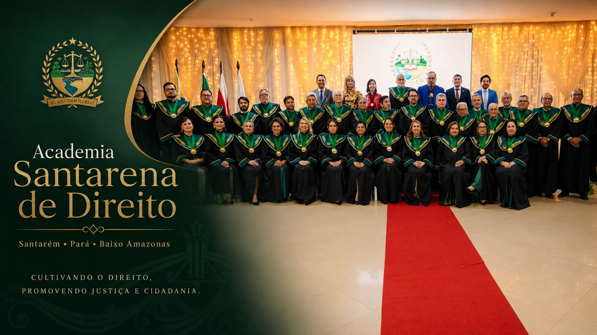

*Na abertura, a frente da cidade vista do rio em «Santarem, dans la province du Para», publicada em 1862. A gravura é catalogada em nome de Auguste François Biard pela [Biblioteca Brasiliana Guita e José Mindlin da USP](https://digital.bbm.usp.br/handle/bbm/3788).*

Em janeiro de 1881, na casa em que o juiz municipal de Santarém despachava, discutiu-se o valor da liberdade de um homem. Severiano havia recorrido à Justiça para obtê-la por arbitramento. Seu curador, Antônio José Auzier, faltou à audiência e atribuiu a ausência ao mau tempo. Quando teve vista dos autos, contestou a avaliação e a escolha dos árbitros. [Rodrigo Caetano Sousa, dissertação da UFAM, capítulo sobre o processo de Severiano, pp. 144 e seguintes](https://drive.google.com/file/d/1a9k4h7v5R-0eVdyZMTytealpBXzzPg0e/view).

A história jurídica de Santarém tem endereços assim. Uma casa serviu de juízo. Um teatro cedeu espaço ao expediente forense. Nos cartórios, negócios de terra, inventários e cartas de liberdade passavam pela mão do escrivão. Mais tarde vieram uma Junta do Trabalho, uma subseção da Ordem, as salas de aula do curso de Direito e uma vara federal. Os documentos dessas instituições podem ser lidos ao lado dos que as próprias comunidades produziram para regular a pesca ou exigir que sua palavra fosse ouvida. [Memórias do antigo foro](/blog/2015-02-07-justica-irmanada-dentro-e-fora-do/) · [Protocolo dos povos Munduruku e Apiaká do Planalto Santareno](https://acervo.socioambiental.org/acervo/documentos/protocolo-de-consulta-dos-povos-indigenas-munduruku-e-apiaka-do-planalto).

## A vila, a Câmara e o ofício de julgar

Quando Francisco Xavier de Mendonça Furtado elevou a aldeia dos Tapajós à categoria de vila, em 14 de março de 1758, deu-lhe o nome português de Santarém. A vila recebeu um Senado da Câmara. Segundo a memória do Legislativo municipal, integravam-no três vereadores, um procurador e um escrivão, sob a presidência de um juiz ordinário. A lista dos ofícios permite enxergar algo que a palavra *Câmara*, no sentido atual, encobre. O homem que presidia os trabalhos também exercia o ofício de julgar. A data assinala uma mudança na administração portuguesa de um território indígena cuja história já vinha de muito antes. [Prefeitura de Santarém, histórico do município](https://santarem.pa.gov.br/institucional/historia-de-santarem) · [Câmara Municipal, memória da instalação, pp. 1 e 2](https://sapl.santarem.pa.leg.br/media/sapl/public/materialegislativa/2025/34053/moc_190_2025_2491_gerlande_aplausos_196_anos_instalacao_da_cms.pdf).

Quase setenta anos depois, uma folha manuscrita levou a vila à Câmara dos Deputados do Império. João Cândido de Deus e Silva apresentou um projeto para criar em Santarém o lugar de juiz de fora. O Arquivo Histórico da Câmara conserva a proposição e remete à leitura nos Anais da sessão de 8 de junho de 1827, página 27, primeira coluna. O manuscrito documenta o pedido do deputado. A instalação efetiva do juízo exigiria outro registro, como o ato de nomeação ou o termo de posse. [Dossiê legislativo de 1827](https://arquivohistorico.camara.leg.br/index.php/br-dfcd-cd1-2-ppl-5pl-1827-22023).

<figure class="historia-figura"><figcaption>Projeto de João Cândido de Deus e Silva. A ficha do arquivo identifica a peça pelo código BR DFCD CD1-2-PPL-5PL-1827-22023-0249. <a href="https://arquivohistorico.camara.leg.br/index.php/br-dfcd-cd1-2-ppl-5pl-1827-22023-0249">Arquivo Histórico da Câmara dos Deputados</a>.</figcaption></figure>

A Lei de 1º de outubro de 1828 redesenhou as câmaras de todo o Império. Seu artigo 24 reservou-lhes atribuições administrativas e retirou-lhes a jurisdição contenciosa, isto é, o poder de decidir litígios. Em Santarém, a instalação da Câmara sob esse regime ocorreu em 1º de junho de 1829. Eram sete membros e um secretário. O padre Raimundo José Auzier foi o primeiro presidente. As posturas municipais continuaram a alcançar matérias tão concretas quanto a criação de animais e a ocupação do solo. Julgar uma demanda e regular a rua passavam, porém, a ser atribuições de autoridades distintas. [Lei imperial de 1828, especialmente arts. 24 e 66](https://www2.camara.leg.br/legin/fed/lei_sn/1824-1899/lei-38281-1-outubro-1828-566368-publicacaooriginal-89945-pl.html) · [Memória da Câmara de Santarém](https://sapl.santarem.pa.leg.br/media/sapl/public/materialegislativa/2025/34053/moc_190_2025_2491_gerlande_aplausos_196_anos_instalacao_da_cms.pdf).

## Uma comarca que precisou mudar de sede

Em 14 de maio de 1833, o Conselho do Governo da Província do Grão-Pará reorganizou a divisão judiciária. Santarém passou a ser termo judiciário e sede da Comarca do Baixo Amazonas. O termo correspondia a uma circunscrição local. A comarca, mais extensa, reunia oito vilas. O primeiro nomeado para o cargo de juiz de direito não tomou posse. Foi o bacharel Joaquim Rodrigues de Sousa quem efetivamente assumiu a jurisdição. [Histórico da comarca reunido por ocasião dos 190 anos, com remissão ao TJPA e a Paulo Rodrigues dos Santos](https://comunicacao.ufopa.edu.br/comunicacao/comunica/jornalismo/ufopa-na-midia-2/2023/maio/sessao-solene-em-comemoracao-aos-190-anos-da-comarca-de-santarem-e-marcada-por-homenagens/) · [TJPA Revista, histórico da organização judiciária paraense](https://www.tjpa.jus.br/CMSPortal/VisualizarArquivo?idArquivo=1487813).

A Cabanagem alterou até o lugar de onde se despachavam os processos. Encarregado de organizar a resistência legalista, Joaquim Rodrigues de Sousa transferiu a sede para Monte Alegre quando os cabanos tomaram Santarém. A transferência perdurou até 1840. O magistrado permaneceu à frente da comarca até 1849, quando lhe sucedeu José Bernardo de Loyola. No intervalo, em 24 de outubro de 1848, a Lei Provincial nº 145 elevara a vila à categoria de cidade. Santarém, portanto, já era sede judiciária antes de receber o título de cidade. [Memória da comarca](https://comunicacao.ufopa.edu.br/comunicacao/comunica/jornalismo/ufopa-na-midia-2/2023/maio/sessao-solene-em-comemoracao-aos-190-anos-da-comarca-de-santarem-e-marcada-por-homenagens/) · [IBGE, histórico administrativo de Santarém](https://www.ibge.gov.br/biblioteca/visualizacao/dtb/para/santarem.pdf).

Outro nome permite seguir o percurso entre a comarca e a capital. Ernesto Adolfo de Vasconcelos Chaves, antes promotor em Pilar e juiz em Bananeiras, na Paraíba, exerceu o juízo de Direito de Santarém em 1879. A galeria histórica do Tribunal paraense registra sua passagem à Vara da Fazenda em 1887, ao Tribunal Superior de Justiça em 1891 e à presidência da Corte por eleição de 4 de julho de 1894. Hoje ele dá nome à Cadeira 13 da Academia. [Galeria dos ex-presidentes do Tribunal de Justiça do Pará, página digital 48](https://www.tjpa.jus.br/CMSPortal/VisualizarArquivo?idArquivo=449961) · [Perfil de Ernesto Chaves](/patronos/ernesto-adolfo-de-vasconcelos-chaves/).

## Os nomes que ficaram nos autos da escravidão

Entre os papéis do Fórum de Santarém cedidos à Universidade Federal do Oeste do Pará há processos cíveis e criminais do início do século XIX a meados do XX. A equipe que se dedicou a sua preservação encontrou referências a pessoas escravizadas em autos de despejo, embargos e nomeações de tutor. O título na capa de um processo raramente basta para saber de quem ele guarda a história. Muitas dessas pessoas só se tornam visíveis quando se abre o maço e se lê o depoimento ou a petição. [Ufopa, pesquisa sobre a preservação dos fundos judiciários e a escravidão negra](https://portaldeperiodicos.ufopa.edu.br/index.php/extensaodaintegracaoamazonica/article/view/2093).

A Lei de 28 de setembro de 1871 permitia à pessoa escravizada obter alforria com o pecúlio suficiente para indenizar seu valor. Havendo desacordo quanto ao preço, cabia o arbitramento. [Lei nº 2.040 de 1871, art. 4º, § 2º](https://www2.camara.leg.br/legin/fed/leimp/1824-1899/lei-2040-28-setembro-1871-538828-publicacaooriginal-35591-pl.html).

Nos autos examinados pelo historiador Rodrigo Caetano Sousa, o avaliador fixou **um conto e quinhentos mil-réis** pela liberdade de Severiano. O curador chamou atenção para uma escritura de venda anterior, de valor inferior, e questionou o procedimento adotado em sua ausência. A questão chegou à Relação de Belém. Um aviso de 11 de agosto de 1886, localizado pelo pesquisador em *O Liberal do Pará*, tratava da entrega do dinheiro para execução do acórdão referente à libertação. Da petição ao vestígio encontrado no jornal decorreram mais de cinco anos. [Sousa, *A derrocada da escravidão em Santarém*, análise dos autos de 1881 e do aviso de 1886](https://drive.google.com/file/d/1a9k4h7v5R-0eVdyZMTytealpBXzzPg0e/view).

<figure class="historia-figura"><figcaption>Primeira página de <em>O Liberal do Pará</em> de 11 de agosto de 1886. Nessa edição, o nome de Severiano aparece no expediente relativo à execução do acórdão. <a href="https://hemeroteca-pdf.bn.gov.br/704555/per704555_1886_00179.pdf">Consultar o exemplar na Hemeroteca Digital da Biblioteca Nacional</a>.</figcaption></figure>

A mesma pesquisa encontrou, no livro do tabelião Moraes Sarmento, duas cartas de liberdade ligadas pelo parentesco. A de Joanna Mathilde foi registrada em 1º de maio de 1883. A de seu filho Mauricio foi registrada em 11 de junho. Ambas impunham prestação de serviços até a morte do senhor. No instrumento de Joanna, ele declarou que ela havia amamentado uma filha e quatro netos seus. A cláusula de serviço explica a distância que podia haver entre receber a carta e poder escolher onde viver e trabalhar. [Sousa, capítulo sobre as alforrias, especialmente p. 117 e nota 389](https://drive.google.com/file/d/1a9k4h7v5R-0eVdyZMTytealpBXzzPg0e/view).

## O que o álbum de 1948 guardou

Para festejar o centenário da elevação à categoria de cidade, a administração municipal publicou, em 1948, um álbum ilustrado. Entre fotografias do porto, prédios públicos e estatísticas do comércio, a comissão organizadora reservou espaço a um cadastro profissional. Na folha 44 aparecem os advogados **Silvério Sirotheau Corrêa** e **Nestor Orlando Miléo**. O impresso preserva uma distinção de época. Alberico Mendes de Nóvoa e Jonathas de Almeida e Silva estão relacionados como *advogados provisionados*. Convém conservar as duas designações ao transcrever o documento. [Fundação Cultural do Pará, cadastro profissional na folha 44](https://obrasraras.fcp.pa.gov.br/publication/file/livros/santarem-album-comemorativo-do-centenario-de-santarem/44/).

<figure class="historia-figura"><figcaption>O porto no álbum comemorativo de 1948. As vistas mostram a frente da cidade pela qual se chegava a uma sede de comarca de alcance regional. <a href="https://obrasraras.fcp.pa.gov.br/publication/file/livros/santarem-album-comemorativo-do-centenario-de-santarem/15/">Fundação Cultural do Pará, folha 15</a>.</figcaption></figure>

<figure class="historia-figura"><figcaption>Acima do cadastro de advogados, o álbum identifica os tabeliães José Otaviano de Matos e Santino Sirotheau Corrêa. A mesma página permite localizar instituições e pessoas. <a href="https://obrasraras.fcp.pa.gov.br/publication/file/livros/santarem-album-comemorativo-do-centenario-de-santarem/44/">Fundação Cultural do Pará, folha 44</a>.</figcaption></figure>

Santino Sirotheau Corrêa, tabelião do 2º Ofício, integrou a comissão que preparou o álbum, ao lado de Jorge Franco de Almeida e Eymar da Cunha Franco. O nome do tabelião aparece tanto na lista dos ofícios como na prancha de retratos dos organizadores. Outras folhas mostram o palacete da Prefeitura, o prefeito em seu gabinete e o Teatro Vitória. O edifício do teatro voltaria a aparecer, décadas depois, nas recordações sobre a falta de instalações próprias para o expediente da Justiça. [Comissão organizadora, folha 12](https://obrasraras.fcp.pa.gov.br/publication/file/livros/santarem-album-comemorativo-do-centenario-de-santarem/12/) · [Palacete e Teatro Vitória, folha 24](https://obrasraras.fcp.pa.gov.br/publication/file/livros/santarem-album-comemorativo-do-centenario-de-santarem/24/) · [Ércio Afonso, recordações do foro santareno](https://ercioafonso.blogspot.com/2024/02/historia-do-poder-judiciario-de.html).

<figure class="historia-figura"><figcaption>Comissão organizadora do álbum. As legendas identificam os retratados pelos respectivos cargos, entre eles o tabelião do 2º Ofício. <a href="https://obrasraras.fcp.pa.gov.br/publication/file/livros/santarem-album-comemorativo-do-centenario-de-santarem/12/">Fundação Cultural do Pará, folha 12</a>.</figcaption></figure>

<figure class="historia-figura"><figcaption>O Teatro Vitória aparece no alto, à direita. A prancha documenta o prédio em 1948. Seu uso posterior pela Justiça é conhecido por testemunho memorialístico. <a href="https://obrasraras.fcp.pa.gov.br/publication/file/livros/santarem-album-comemorativo-do-centenario-de-santarem/24/">Fundação Cultural do Pará, folha 24</a>.</figcaption></figure>

## Justiça do Trabalho, escrivanias e advocacia

O artigo 3º da Lei nº 4.088, de 12 de julho de 1962, criou uma Junta de Conciliação e Julgamento em Santarém. A instalação ocorreu em **29 de dezembro de 1963**. Célio Rodrigues Cal foi o primeiro juiz do Trabalho da cidade. Maria de Lourdes Matos Cercasin, a primeira chefe de secretaria. Ao recordar a Junta, Vicente José Malheiros da Fonseca localizou na Travessa Inácio Corrêa a sala de sua primeira audiência em Santarém. Guardou também os nomes dos servidores que recebiam as partes e faziam correr os processos. [Câmara dos Deputados, texto original da Lei nº 4.088](https://www2.camara.leg.br/legin/fed/lei/1960-1969/lei-4088-12-julho-1962-353861-publicacaooriginal-1-pl.html) · [Cadastro histórico das Varas do Trabalho, entrada de Santarém](https://docs.trt10.jus.br/docs/varas/vt-regiao8-paap.pdf) · [Revista do TRT da 8ª Região, nº 91, depoimento de Vicente Fonseca](https://www.trt8.jus.br/sites/portal/files/pdfs/revista/Revista_91.pdf).

Na Justiça estadual, parte da história do trabalho diário ficou registrada em dois depoimentos publicados juntos em 2015. Ismaelino Valente chegou de Oriximiná em 1977 para exercer a promotoria. Lembra-se de advogados já estabelecidos, entre eles Nestor Miléo e Celso Bastos Soares, e de uma geração cujo começo acompanhou, como Tito Viana, Zulmira Mota de Azevedo e Ana Elvira Alho. Entre os magistrados cita Albanira Lobato Bemerguy. Entre os escrivães, João de Souza Alho, Sebastião Nogueira Sirotheau e Carmelita Bentes Vieira. José Ronaldo Dias Campos, por sua vez, descreve as três escrivanias que conheceu ao ingressar na advocacia na década de 1980. Funcionavam em ligação com os tabelionatos. Lidos em conjunto, os relatos permitem recompor quem redigia, recebia e movimentava os autos. [Ismaelino Valente e José Ronaldo Dias Campos, memórias das serventias santarenas](/blog/2015-02-07-justica-irmanada-dentro-e-fora-do/).

Em 1979, a advocacia passou a contar com a Subseção de Santarém da OAB. A galeria da entidade registra três gestões consecutivas de Benedito Fernandes da Silva, de 1979 a 1985. Seguiram-se José Olivar de Azevedo, José Ronaldo Dias Campos e Evandro Diniz Soares, que presidiu a Subseção de 1993 a 1995. Outra espécie de arquivo sobreviveu nas próprias causas. Dias Campos conta que, ao assumir uma ação de imissão de posse conhecida pelo nome do imóvel, *Sombra da Lua*, encontrou petições antigas de Silvério e de outros colegas. Descreveu as folhas de papel almaço e o texto datilografado. A continuidade de um único litígio lhe permitiu conhecer a escrita de um advogado que já havia falecido quando ele entrou para a Ordem. [Galeria de ex-presidentes da OAB Santarém](https://oabsantarem.org.br/ex-presidentes) · [José Ronaldo Dias Campos, *Por que o escolhi como patrono*](/blog/2026-07-10-por-que-o-escolhi-como-patrono/).

<figure class="historia-figura"><figcaption>Benedito Fernandes da Silva, primeiro presidente da Subseção de Santarém. Retrato da galeria histórica da Ordem reproduzido na revista de José Ronaldo Dias Campos. <a href="https://oabsantarem.org.br/ex-presidentes">OAB Santarém, galeria da presidência</a>.</figcaption></figure>

## Estudar Direito e recorrer à Justiça Federal no oeste do Pará

A primeira turma do curso de Direito da Universidade Federal do Pará em Santarém começou as aulas em agosto de 1994 e colou grau em maio de 2000. O projeto pedagógico identifica o ato de criação, a Resolução nº 2.129/93. Entre o ingresso e a formatura dessa turma, outra resolução, a de nº 2.535, de 16 de outubro de 1998, criou o Núcleo de Prática Jurídica. O núcleo começou a funcionar em 1999, oferecendo estágio supervisionado aos estudantes e atendimento jurídico gratuito à população de baixa renda. O curso e sua experiência de atendimento passaram a integrar a trajetória da Universidade Federal do Oeste do Pará. [Ufopa, projeto pedagógico e histórico do curso](https://arquivos-producao.ufopa.edu.br/arquivos/2020001094376f2563255a031669d1bd/PPC_do_Curso_de_Direito.pdf) · [Ufopa, histórico do Núcleo de Prática Jurídica](https://www.ufopa.edu.br/media/file/site/ufopa/documentos/2026/2628b6a4-f96a-455d-a53f-e16b457e8785.pdf).

Quase ao mesmo tempo, em 27 de outubro de 1995, instalou-se a Vara Federal de Santarém. A lei de criação datava de janeiro de 1987. Oito anos separam, portanto, o ato legislativo da abertura da unidade. Antônio Souza Prudente foi seu primeiro juiz. A segunda vara seria instalada em 25 de janeiro de 2012. Em balanço de 2015, a Seção Judiciária relacionava quinze municípios atendidos pelas duas varas, entre eles Alenquer, Faro, Juruti, Óbidos, Oriximiná e Terra Santa. Para quem morava em Faro ou em Oriximiná, uma causa federal podia começar longe do balcão do fórum, em uma viagem de barco até Santarém. [Seção Judiciária do Pará, histórico e jurisdição da Subseção](https://www.trf1.jus.br/sjpa/noticias/subsecao-de-santarem-chega-aos-20-anos-com-12%2C6-mil-processos-em-tramitacao).

## O Direito escrito pelas comunidades

Em 2017, indígenas Munduruku e Apiaká do Planalto Santareno registraram por escrito como deveriam ser consultados diante de projetos capazes de afetar suas terras e seus direitos. A elaboração reuniu as aldeias Açaizal, São Francisco da Cavada, Ipaupixuna, Amparador e São Pedro do Palhão. Ao lado de leis, portarias e decisões judiciais, o protocolo merece lugar próprio num arquivo jurídico de Santarém. Quem lê o documento encontra a palavra das comunidades sobre como uma decisão pública deve chegar até elas. [Protocolo de consulta de 2017, acervo do Instituto Socioambiental](https://acervo.socioambiental.org/acervo/documentos/protocolo-de-consulta-dos-povos-indigenas-munduruku-e-apiaka-do-planalto) · [Observatório de Protocolos Comunitários, histórico da elaboração](https://observatorio.direitosocioambiental.org/protocolo-de-consulta-dos-povos-indigenas-munduruku-e-apiaka-do-planalto-santareno-2017/).

Outro documento nasceu do uso das águas. Em 15 de junho de 2023, a Secretaria de Estado de Meio Ambiente e Sustentabilidade homologou o acordo de pesca do Lago Grande do Curuai, que abrange partes de Santarém, Óbidos e Juruti. A portaria ocupa uma coluna do Diário Oficial. O acordo celebrado pelos pescadores vem em anexo, com um mapa. A disposição da página permite ler separadamente o ato de homologação do Estado e as regras pactuadas para o lago. [Diário Oficial do Pará, edição extra nº 35.436, p. 6 e seguintes](https://www.ioepa.com.br/arquivos/2023/2023.06.15.EXTRA.pdf).

<figure class="historia-figura"><figcaption>Portaria Semas nº 1.129, de 15 de junho de 2023. Na mesma página começam as disposições do acordo de pesca do Lago Grande do Curuai. <a href="https://www.ioepa.com.br/arquivos/2023/2023.06.15.EXTRA.pdf">Imprensa Oficial do Estado do Pará, edição extra, p. 6</a>.</figcaption></figure>

## Guardar os autos, devolver os nomes

Em 17 de agosto de 2026, na sede da Subseção da OAB em Santarém, a assembleia de fundação da Academia Santarena de Direito aprovou o estatuto e confirmou os patronos das cadeiras. A solenidade de posse dos fundadores ocorreu no dia 21. Uma cadeira guarda um nome. Os autos, os retratos e os testemunhos permitem ir além da homenagem e perguntar o que aquela pessoa fez, em qual ofício, perante qual juízo, em companhia de quem. [José Ronaldo Dias Campos, registro da assembleia de fundação](https://joseronaldodiascampos.blogspot.com/2026/08/academia-santarena-de-direito.html) · [Galeria fotográfica da Academia](/galeria/).

<figure class="historia-figura"><figcaption>Sessão solene de posse dos acadêmicos fundadores em Santarém, 21 de agosto de 2026. <a href="/galeria/">Acervo da Academia Santarena de Direito</a>.</figcaption></figure>

Há ainda nomes que nenhuma galeria profissional teria razão para conservar. Joanna Mathilde, Mauricio e Severiano chegaram até nós porque sobreviveram um livro de notas, os autos de um arbitramento e um exemplar de jornal. Preservar esses papéis permite escrever a história da Justiça também do ponto de vista de quem precisou recorrer a ela para dispor da própria vida. [Pesquisa de Rodrigo Caetano Sousa, UFAM](https://www.ppgh.ufam.edu.br/dissertacoes-2023.html) · [Acervo judicial preservado pela Ufopa](https://portaldeperiodicos.ufopa.edu.br/index.php/extensaodaintegracaoamazonica/article/view/2093).
